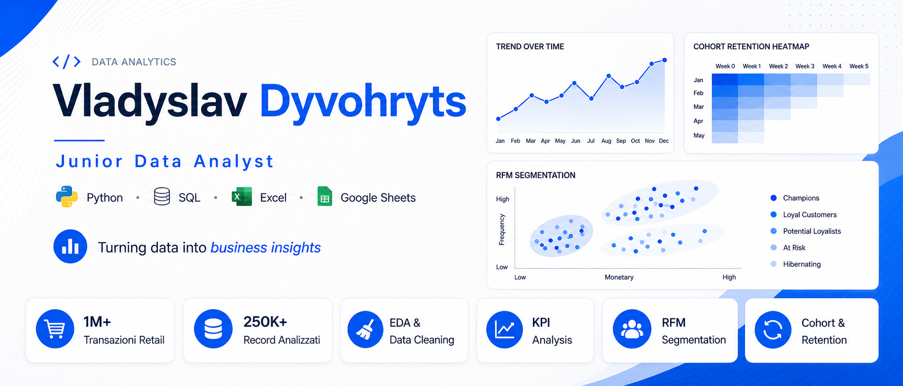

  

---

## 👨‍💻 Chi sono

Sono un **Data Analyst** con esperienza in analisi dei dati, reportistica, KPI e gestione CRM, maturata in ruoli di **Business Analyst** e **Data Analyst**.

Attualmente mi occupo di analisi di mercato e gestione dati tramite **CRM Lenus**. Ho inoltre sviluppato competenze pratiche in **Python, SQL, Excel, Power BI e Data Visualization** attraverso formazione specialistica e progetti di analisi dati.

Nei miei progetti ho lavorato su:

- Data Cleaning e preparazione dei dati;
- Exploratory Data Analysis (EDA);
- definizione e calcolo di KPI;
- analisi delle vendite e del comportamento dei clienti;
- segmentazione RFM;
- Cohort Analysis e analisi della retention;
- Data Visualization e comunicazione degli insight.

Sto completando la laurea in **Economia e Management** e ho concluso il percorso di alta formazione **Data/AI Analyst presso Develhope**.

Il mio percorso combina competenze analitiche e conoscenze economico-manageriali, permettendomi di interpretare i dati anche dal punto di vista del business.

📍 Battipaglia, Salerno, Italia  
💼 Aperto a opportunità in ambito **Data Analysis** e **Business Intelligence**

---

---

## 🛠️ Competenze tecniche

### Analisi dei dati

### Database e SQL

`CTE` · `Window Functions` · `Aggregazioni` · `Subquery` · `Data Cleaning`

### Fogli di calcolo e reporting

`Tabelle Pivot` · `Dashboard` · `KPI Analysis` · `Reporting`

### Data Visualization

### Versionamento e strumenti

---

## 📊 Progetti in evidenza

### 🛒 Retail Sales Analytics

Analisi end-to-end di oltre **1 milione di transazioni e-commerce**, realizzata per comprendere le performance commerciali, il comportamento dei clienti e la loro fidelizzazione nel tempo.

#### Attività svolte

- unione e ispezione dei dataset;
- gestione di valori mancanti e righe duplicate;
- identificazione e separazione dei resi;
- trattamento degli outlier;
- Feature Engineering;
- Exploratory Data Analysis;
- analisi geografica e temporale delle vendite;
- analisi dei prodotti e delle fasce orarie;
- calcolo dei principali KPI commerciali;
- segmentazione dei clienti tramite modello **RFM**;
- classificazione dei clienti in **10 segmenti di business**;
- **Cohort Analysis** basata sul mese del primo acquisto;
- creazione della matrice della **Retention Rate**;
- individuazione di trend utili alle strategie di fidelizzazione.

#### KPI analizzati

- fatturato complessivo;
- numero di ordini;
- numero di clienti;
- Average Order Value;
- frequenza media di acquisto;
- Recency, Frequency e Monetary Value;
- Customer Retention Rate.

#### Insight principale

L’analisi delle coorti evidenzia una forte riduzione della retention dopo il primo mese, con percentuali generalmente comprese tra il **20% e il 35%**, e una riattivazione stagionale dei clienti durante il periodo natalizio.

#### Tecnologie

`Python` · `Pandas` · `NumPy` · `Matplotlib` · `Seaborn` · `Jupyter Notebook`

➡️ **[Visualizza il progetto Retail Sales Analytics](https://github.com/VladDyvo/retail_sales_analytics)**

---

### 💼 Job Salary Analysis

Analisi esplorativa di **250.000 record** relativi al mercato del lavoro, sviluppata per comprendere quali fattori sono associati alle differenze salariali tra lavoratori, Paesi e modalità di lavoro.

#### Domande di business

1. Quanto incide il livello di istruzione sullo stipendio?
2. Quali Paesi offrono le retribuzioni migliori ai profili junior?
3. Qual è il ritorno economico delle certificazioni?
4. Esiste un punto oltre il quale aggiungere nuove competenze produce benefici salariali marginali?
5. Il lavoro da remoto è associato a una retribuzione maggiore?

#### Attività svolte

- esplorazione e pulizia del dataset con SQL;
- filtraggio e aggregazione dei dati;
- creazione di metriche salariali;
- confronto tra Paesi e livelli di esperienza;
- analisi del premio salariale dell’istruzione;
- analisi del ROI delle certificazioni;
- studio della relazione tra numero di competenze e stipendio;
- confronto tra lavoro remoto, ibrido e in presenza;
- creazione di dashboard e visualizzazioni con Google Sheets.

#### Tecnologie

`SQL` · `Google Sheets` · `Data Analysis` · `Data Visualization` · `Dashboard`

➡️ **[Visualizza il progetto Job Salary Analysis](https://github.com/VladDyvo/job-salary-analysis-sql)**

---

## 🎓 Formazione

### Data/AI Analyst — Develhope

Percorso di alta formazione attualmente in corso, con approfondimenti su:

- Python per l’analisi dei dati;
- SQL e database relazionali;
- Pandas e NumPy;
- Excel e Google Sheets;
- Data Visualization;
- statistica e probabilità;
- regressione lineare;
- A/B Testing;
- Data Storytelling;
- PySpark e SparkSQL;
- pipeline ETL;
- Apache Airflow;
- Data Ethics e GDPR;
- Prompt Engineering e applicazioni AI.

### Economia e Management — Università degli Studi di Salerno

Percorso universitario in **Economia e Management**, curriculum in **Gestione delle Imprese**, con focus su:

- analisi economico-finanziaria;
- organizzazione aziendale;
- gestione d’impresa;
- processi decisionali;
- interpretazione dei dati in ambito business.

---

## 🌱 Competenze in approfondimento

Attualmente sto lavorando su:

- SQL avanzato e ottimizzazione delle query;
- Tableau e strumenti di Business Intelligence;
- progettazione di dashboard professionali;
- Data Storytelling;
- PySpark e analisi Big Data;
- pipeline ETL con Apache Airflow;
- sviluppo di progetti basati su problemi aziendali reali.

---

## 🎯 Obiettivo professionale

Sto cercando un’opportunità come **Junior Data Analyst** o **Junior Business Intelligence Analyst** nella quale poter:

- analizzare dati reali;
- creare report e dashboard;
- monitorare KPI;
- individuare trend e anomalie;
- trasformare i risultati delle analisi in indicazioni utili al business;
- continuare a sviluppare le mie competenze tecniche e analitiche.

---

## 📫 Contatti

